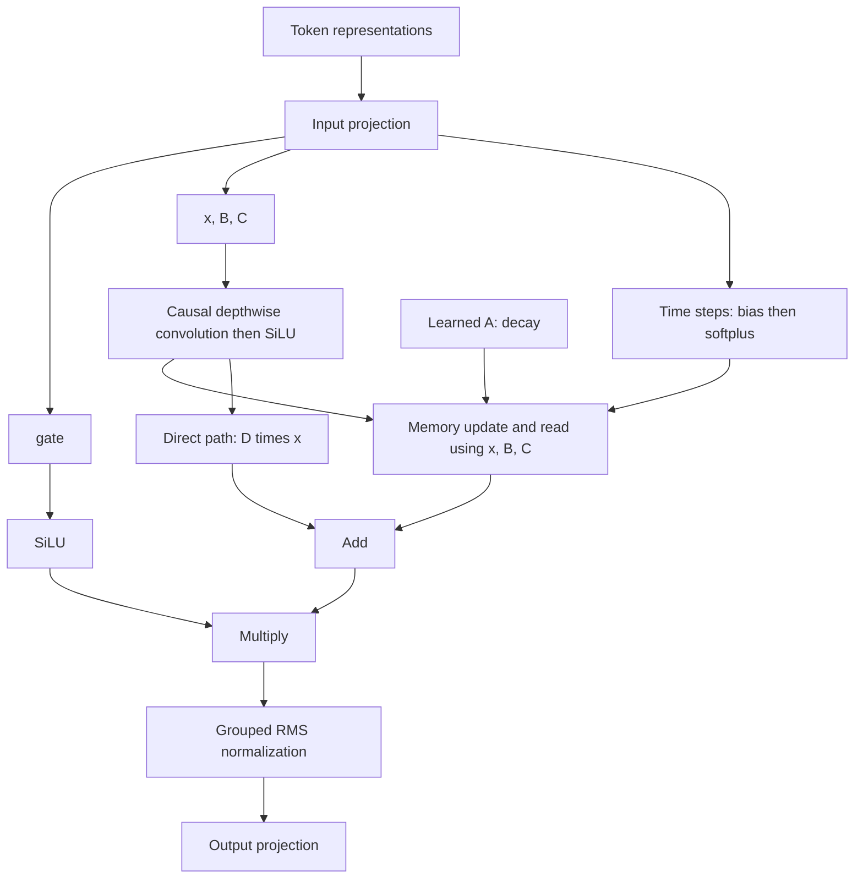

# Before coding: the architecture and the memory

Read this before Exercise 01. Nothing here requires writing code.

## Where Mamba fits in Nemotron

The model turns token IDs into vectors, processes those vectors through a stack
of residual blocks, then projects them to next-token scores:

```text
token IDs -> embeddings -> hybrid residual blocks -> final norm -> vocabulary logits
```

The stack contains Mamba-2 mixers, attention mixers, and dense MLP blocks.
The checkpoint specifies their order. A Mamba block carries information across
tokens using recurrent memory; an attention block retrieves information from
earlier token representations; an MLP transforms each position independently.
We will first build the Mamba mixer in isolation using tiny dimensions.

## State: what is carried from one token to the next?

A state is a tensor summarizing the past. Imagine reading a sentence one word
at a time while updating a fixed-size notebook. The notebook is learned numeric
features, not a literal list of words or a set of human-labeled facts.

Distinguish the current token representation from this persistent memory:

- The token representation enters and leaves the layer at each position.
- The SSM state survives from one position to the next, initially filled with zeros.
- Model parameters are learned during training; the state is computed for each input.

In this Mamba-2 mixer each head processes `head_dim` channels. Every channel has
`state_size` memory coordinates, so one head's state is a matrix:

```text
one head:       [head_dim, state_size]
all examples:   [batch, heads, head_dim, state_size]
```

`state_size` counts memory coordinates per channel, not tokens remembered.
This tensor's size stays fixed as the sequence grows; information can be lost
as the notebook is updated. Cached decoding also needs a separate short buffer
for the causal convolution. Our `MambaState` container will hold both buffers.

## A, B, C, and D come from state-space models

A conventional continuous-time SSM is written as:

```text
ds(t)/dt = A * s(t) + B * x(t)
y(t)     = C * s(t) + D * x(t)
```

Their roles carry over: A governs memory evolution, B writes input to memory,
C reads memory into output, and D provides a direct input-to-output path.
Mamba makes B, C, and the time step input-dependent, allowing the current token
to control how memory is used.

Here is the recurrence for one head, with the batch and head indices omitted.
Let p index channels and n index state coordinates. `dt[t]` denotes the
positive time step at token t; `*` denotes multiplication:

```text
decay[t] = exp(dt[t] * A)

S[t, p, n] = decay[t] * S[t-1, p, n]
             + dt[t] * x[t, p] * B[t, n]

y[t, p] = sum over n of (S[t, p, n] * C[t, n]) + D * x[t, p]
```

The write term is an outer product: a channel vector times a state vector
produces a matrix. The read sums over state coordinates, returning a channel
vector. These equations describe this mixer's update; do not substitute a
different SSM discretization when we implement it.

In Mamba-2, A has a particularly simple structure: one learned negative scalar
per head, applied to every entry of that head's state. It is represented by
`A_log`, with `A = -exp(A_log)`. Positive time steps come from softplus applied
to a projected value plus a learned bias. Thus the exponential multiplier lies
between zero and one, controlling how much previous memory survives.

A itself does not vary by token, but its effective decay does because the time
step varies. A and D are standalone learned parameters; B and C are generated
from the input. This is why A is absent from the projection split in Exercise 01.

## Groups: which heads share B and C?

A group is a collection of heads that use the same B and C vectors at a given
position. It is an architectural sharing rule, not a collection of tokens.
Heads retain separate states, x values, A values, D values, and time steps.

Our tiny configuration has four heads and two groups:

```text
group 0: B0, C0 -> head 0 (own state), head 1 (own state)
group 1: B1, C1 -> head 2 (own state), head 3 (own state)
```

Sharing the write/read vectors reduces the channels the input projection must
produce. It resembles grouped-query attention's sharing of K/V across query
heads, though these tensors serve different mathematical roles.

Before sharing across heads, B and C each have shape
`[batch, length, groups, state_size]`. They vary with the token and example.
The number of heads must be divisible by the number of groups.

## The complete mixer



The convolution mixes nearby positions. The recurrence carries information
across the prefix. Gating and normalization process the recurrence output;
the final projection restores the original token width. The surrounding block
also has a residual connection and normalization, omitted from this mixer diagram.

Now read [Exercise 01](01-mamba-shapes.md). Before calculating widths, explain:
what persists between tokens, what heads share, and why A needs no projected slice.

Reference: [NVIDIA's mixer implementation](https://huggingface.co/nvidia/NVIDIA-Nemotron-3-Nano-4B-BF16/blob/main/modeling_nemotron_h.py).
